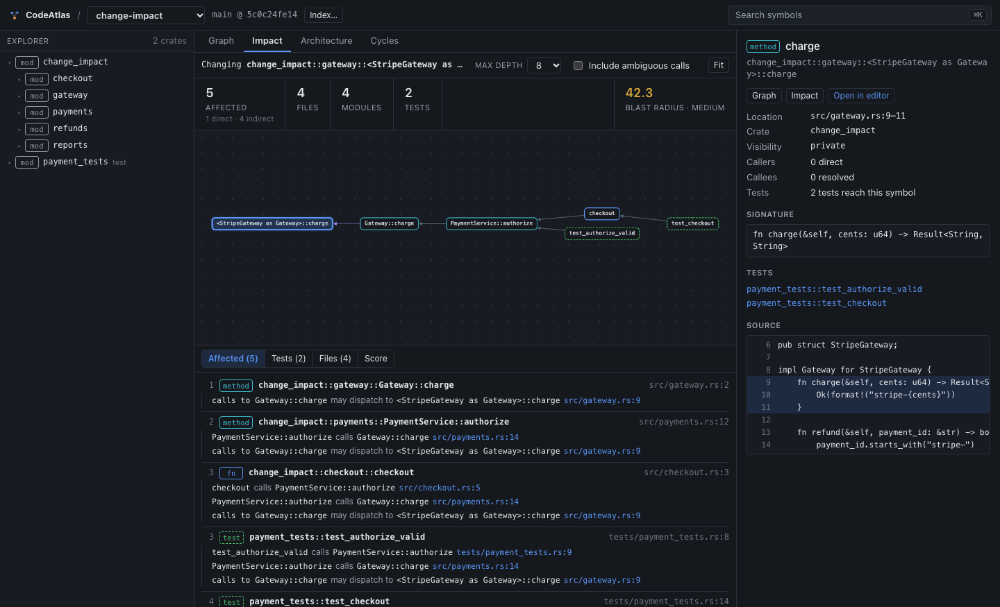

# CodeAtlas

You change a function in a Rust project. What else uses it, and which tests should you run? CodeAtlas reads the source code, traces those connections, and shows the files and lines behind each result. It helps you investigate a change before merging it.

```text
$ ./target/release/codeatlas diff /tmp/pr-shop --base main --head feature
PR impact   main..feature  (...)
Files       9 changed: 1 added, 1 removed, 6 modified, 1 renamed
Functions   4 modified, 1 added, 1 removed
Signatures  1 changed
Tests       1 modified
...
Potential impact (resolved calls and trait dispatch, depth <= 8)
  5 downstream symbols in 3 modules and 3 files; 3 tests to run

Changed symbols
...
  ~ method pr_shop::payments::PaymentService::authorize                 src/payments.rs:13-14
      signature before: pub fn authorize(&self, cents: u64) -> Result<String, String>
      signature after:  pub fn authorize(&self, amount: u64, currency: &str) -> Result<String, String>
...
Recommendation  run the selected tests (no known blind spot applies; this is a heuristic, not a guarantee)
```

(Trimmed output from the `pr-impact` fixture, which `scripts/make-pr-fixture.sh /tmp/pr-shop` builds.) There's also a SvelteKit workspace backed by Neo4j for exploring callers, impact, branch changes, cycles, and crate and module dependencies, and a GraphQL API that also answers dependency paths, hotspots, and layers. The server has no authentication and is meant for local use.



(This screenshot predates the Changes view, the *Why?* buttons, and the Explain tab.)

## Try it

Requires Rust 1.90+, a C compiler (for tree-sitter), and Git. These need neither Neo4j nor a model:

```bash
cargo build --release
./target/release/codeatlas analyze fixtures/simple-repo
./target/release/codeatlas evaluate fixtures/cross-module
```

For the interactive workspace, follow the [installation guide](GUIDE.md#installation).

## Decisions worth explaining

**Keep uncertain connections visible.** The parser, tree-sitter, reads code structure but does not have the Rust compiler’s type information. When a call could refer to more than one definition, CodeAtlas records why it is uncertain and excludes it unless you ask to include ambiguous calls.

**The analysis works without a model.** An optional local model through Ollama can explain an impact result (not a diff report). It receives the question and numbered analysis facts. Its answer is rejected if it cites a fact that does not exist, cites none, or states a relationship involving code outside the facts. That check cannot catch every misreading, and no real model has been evaluated.

**Check the suggested tests against actual failures.** `probe-tests` deliberately makes functions panic, one at a time, and records which tests fail. It builds and runs the repository's own code, so use it only on code you trust. Across ripgrep, serde_json, itertools and bytes (160 probes, 107 of them executed by some test, run in containers without network access), CodeAtlas's selection found 7.6% of the failing tests, or 23.8% when ambiguous calls are included; without ambiguous calls, 80% of the misses are tests that exist only after macro expansion, which it cannot see. On the same probes, two simple baselines found 51.2% of the failing tests (name-mention: every test in a crate that mentions the changed function's name) and 25.5% (file-dependency: every test in the changed file or in files that depend on it). Running the tests of the changed package and of the workspace packages that depend on it found all of them, but on three of the four repositories that is the whole suite. So a heuristic check looks for known reasons why selective execution is unsafe and recommends the full suite when it finds one, which on these four repositories was every time. The suggestions help with investigation; they cannot replace the full suite. See the [external evaluation](benchmarks/external/README.md) and [test-impact quality](GUIDE.md#test-impact-quality).

## Limits

Macros, conditional compilation (`#[cfg]`), and indirect calls can hide connections from the analysis. A dependency path shows what might be affected; it does not prove that a change breaks anything. Analysis takes about 330 ms on ripgrep and 920 ms on tokio on an Apple M5, and incremental indexing is 4–8 times faster than a full index when nothing or one line in one file changed (measured October 6, 2026, v0.1.0) ([method and raw results](benchmarks/README.md)).

Run `cargo test --workspace` for the Rust suite. Without a Neo4j password configured, the database tests are skipped but still reported as passed; in CI they fail instead.

[Architecture](docs/architecture.md) · [Symbol resolution](docs/symbol-resolution.md) · [GraphQL API](docs/api.md) · [Full guide](GUIDE.md) · [MIT license](LICENSE)
