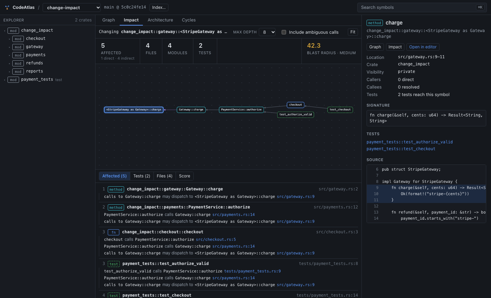

# CodeAtlas

A Rust code-analysis tool for exploring what a change might affect. It traces dependencies to functions, modules, files, and tests, with source links explaining each connection.

**Rust · tree-sitter · Neo4j · GraphQL · SvelteKit · TypeScript**

I built this around a simple requirement: an impact report should show the code behind its answer. The analyzer resolves references from parsed source, keeps ambiguous calls separate, and follows the resulting graph. A local language model can explain that evidence, but the core analysis runs without one.

## Try it

Requires Rust 1.90+ and Git. From the repository root:

```bash
cargo build --release
./target/release/codeatlas analyze fixtures/simple-repo
./target/release/codeatlas evaluate fixtures/cross-module
```

These commands need neither Neo4j nor a model. For the interactive workspace, follow the [installation guide](GUIDE.md#installation); it covers the database, server, and frontend.

## What you can explore

- Callers, dependencies, and paths between symbols.
- Code and candidate tests affected by a symbol change or Git diff.
- Dependency cycles, architecture views, and graph hotspots.
- Incremental indexing that reuses unchanged file analysis.



## Evaluation and limits

Fixtures contain hand-written expected results. Fault-injection experiments compare selected tests with tests that actually fail; see [test-impact quality](GUIDE.md#test-impact-quality). This is static analysis, not the Rust compiler: macro-generated tests and indirect calls reduce coverage. An impact path means a dependency exists, not that a change will necessarily break it.

Run `cargo test --workspace` for the Rust suite; database-dependent checks need Neo4j. The [verification guide](GUIDE.md) explains the full test and benchmark setup.

[Architecture](docs/architecture.md) · [Symbol resolution](docs/symbol-resolution.md) · [GraphQL API](docs/api.md) · [Full guide](GUIDE.md)
